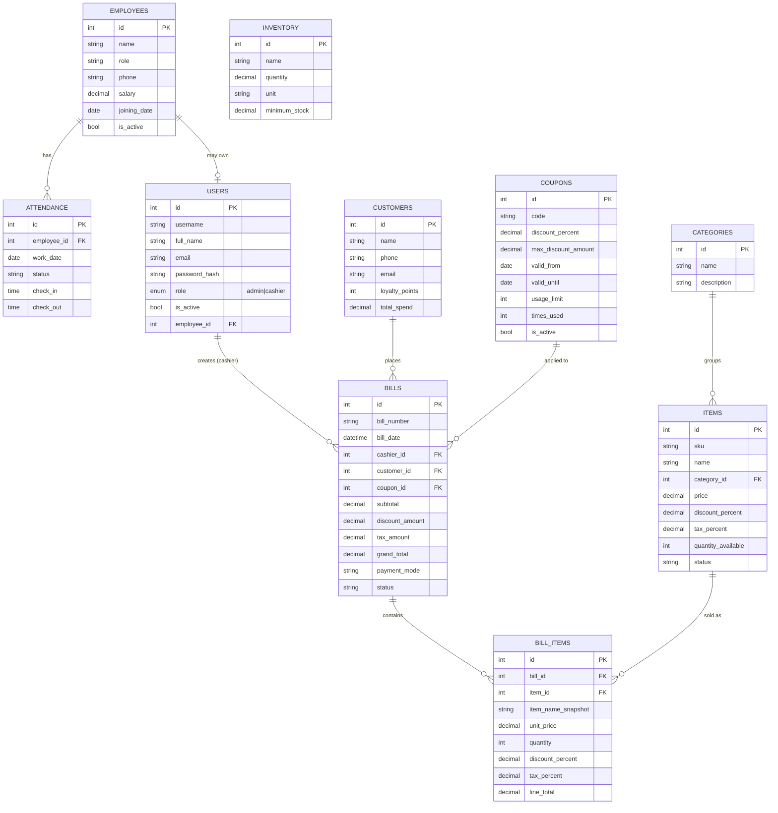

# Entity-Relationship Diagram

`INVENTORY` (raw materials / ingredients) is intentionally **not** linked to
`ITEMS` with a formal recipe/BOM table in this version - see
`docs/ROADMAP.md` for the recipe-costing feature that would connect the two.

Full SQL DDL: [`database/schema.sql`](../database/schema.sql).
